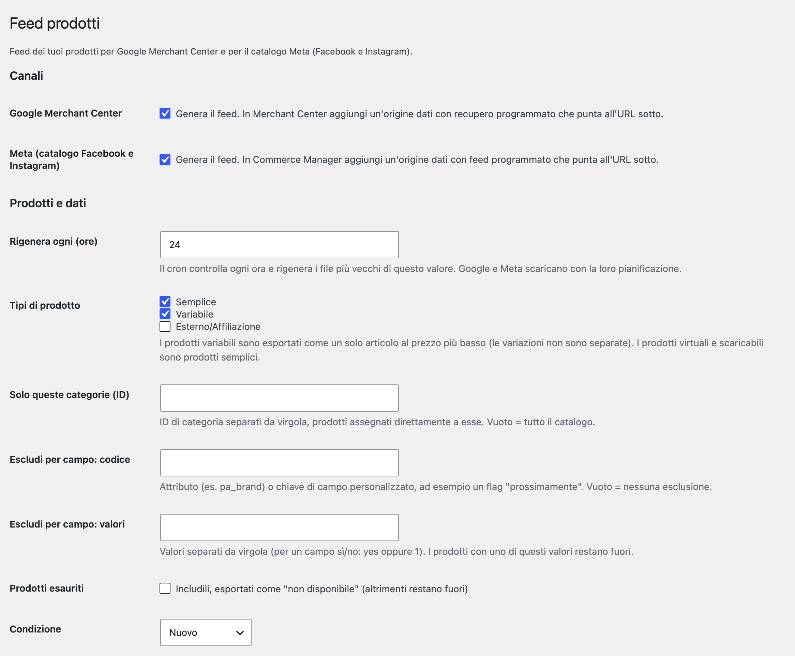
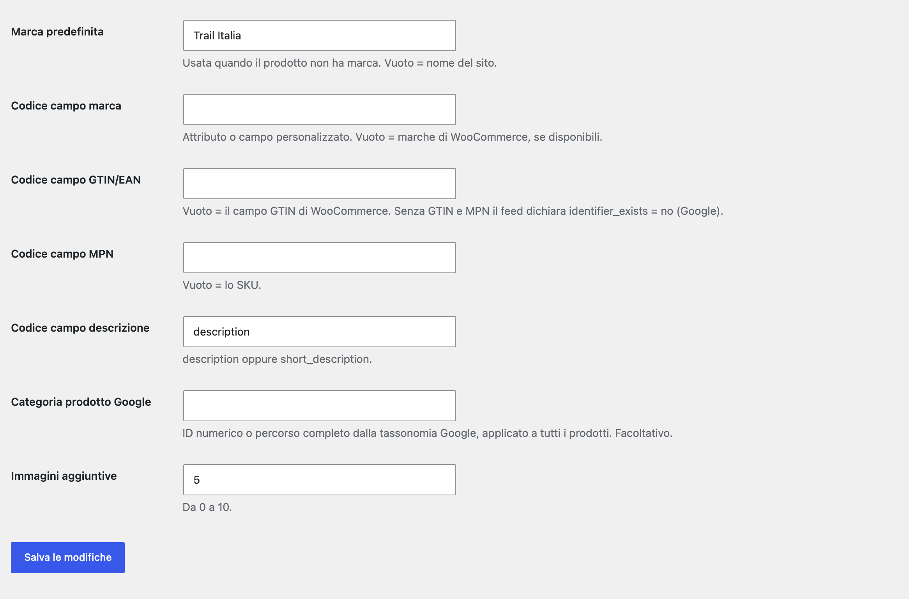

# Threecommerce Product Feed: Google Merchant Center and Meta catalog feeds for WooCommerce

A WooCommerce plugin that builds the **product feeds** for **Google Merchant Center** and the **Meta catalog** (Facebook and Instagram). It is the WooCommerce port of our Magento 2 module.

**Compatibility:** WordPress 6.0+ · WooCommerce 8.0+ · PHP 8.1 – 8.4 · HPOS · Block-based checkout
**License:** commercial · coming soon

## Features

- **One XML feed per channel** (RSS 2.0 with the `g:` namespace, accepted by Google and Meta), rebuilt by WP-Cron or with `wp threecommerce productfeed generate`; one feed per language with WPML or Polylang.
- **Secret feed URL** with a token derived from the WordPress salts, to paste in Merchant Center (scheduled fetch) or Commerce Manager (scheduled feed). The file is written to a temporary name and renamed when done, so a fetch never sees half a file.
- **Prices with tax as in the shop**, sale price, availability, additional images, brand, GTIN, MPN, Google product category and a product type built from the deepest category path.
- **Filters**: product types (simple, variable, external), categories, a field or attribute to exclude by (for example a "coming soon" flag) and out-of-stock handling.
- **Variable products** are exported as a single item at the price of the cheapest variation.
- Google gets `identifier_exists = no` when a product has neither GTIN nor MPN. Items without an image are left out, and so are items with a zero price unless you enable the option for free products.
- Uses the native WooCommerce brands and GTIN field when available.
- Settings page with the feed URLs, the date and size of the last build and a *Generate now* button. Italian translation included.

## Requirements

- WordPress 6.0 or newer
- PHP 8.1 – 8.4
- WooCommerce 8.0 or newer
- Working WP-Cron (or a system cron calling `wp-cron.php`)

## Known limits

- Variations are not exported separately (planned for a later version); no API; grouped products are not exported.
- Pre-orders are not handled: use the exclusion field to keep "coming soon" products out.
- Approval of the products depends on your Google and Meta accounts and on their rules (domain verification, shipping, returns and tax settings stay on the Google and Meta side).

## Tested with

The pure formatting and file-naming code is covered by automated unit tests, and the plugin has been run on a local WordPress / WooCommerce installation (simple, variable and external products, 22% tax, filters, cron and WP-CLI). The multilingual part has not been tested with the real WPML or Polylang plugins, and it has not yet been tested on a live shop.

## Availability

This plugin is **not yet available for purchase**. See the [product page](https://www.threecommerce.it/feed-prodotti-google-merchant-meta-woocommerce?utm_source=github&utm_medium=readme&utm_campaign=woocommerce-product-feed) for its status, or [get in touch](https://www.threecommerce.it/contatti?utm_source=github&utm_medium=readme&utm_campaign=woocommerce-product-feed) to be notified at launch or to ask for information.

## Configuration

*WooCommerce → Product Feed*: channels, regeneration interval, product types, categories, exclusion field, out-of-stock products, condition, brand, GTIN, MPN, description field, Google category and number of additional images.

## Documentation and support

- Product page: [threecommerce.it/feed-prodotti-google-merchant-meta-woocommerce](https://www.threecommerce.it/feed-prodotti-google-merchant-meta-woocommerce?utm_source=github&utm_medium=readme&utm_campaign=woocommerce-product-feed)
- [Changelog](CHANGELOG.md) (in Italian)
- Support and custom development: [threecommerce.it/contatti](https://www.threecommerce.it/contatti?utm_source=github&utm_medium=readme&utm_campaign=woocommerce-product-feed)

---

*This repository is the public showcase of the plugin. The source code is kept in a private repository.*
